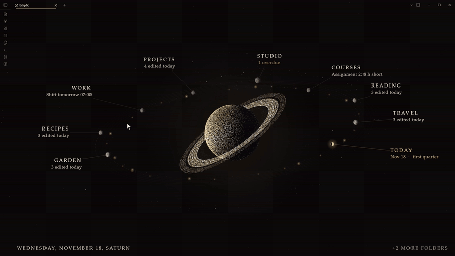
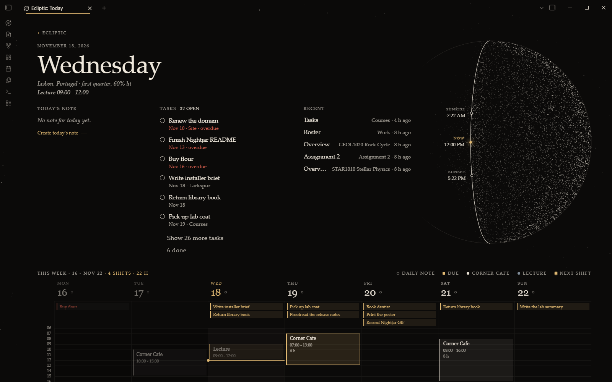
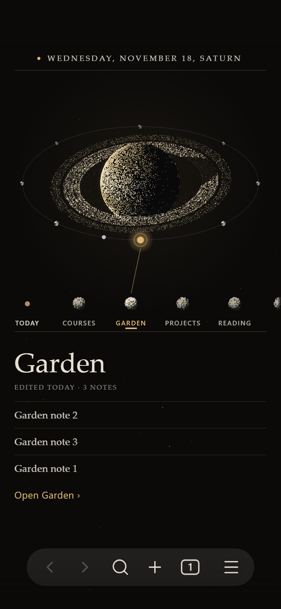
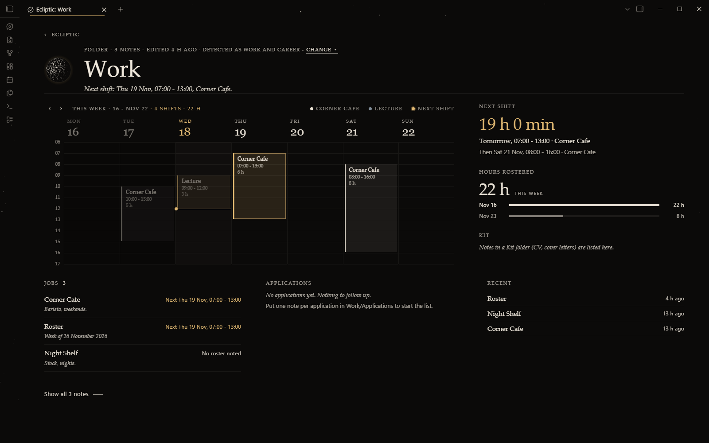
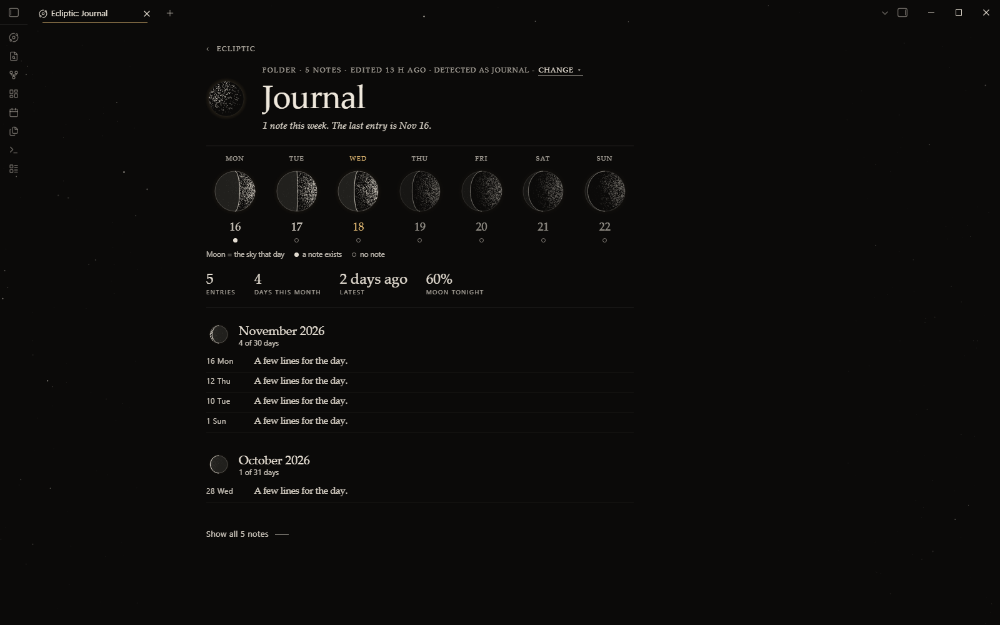
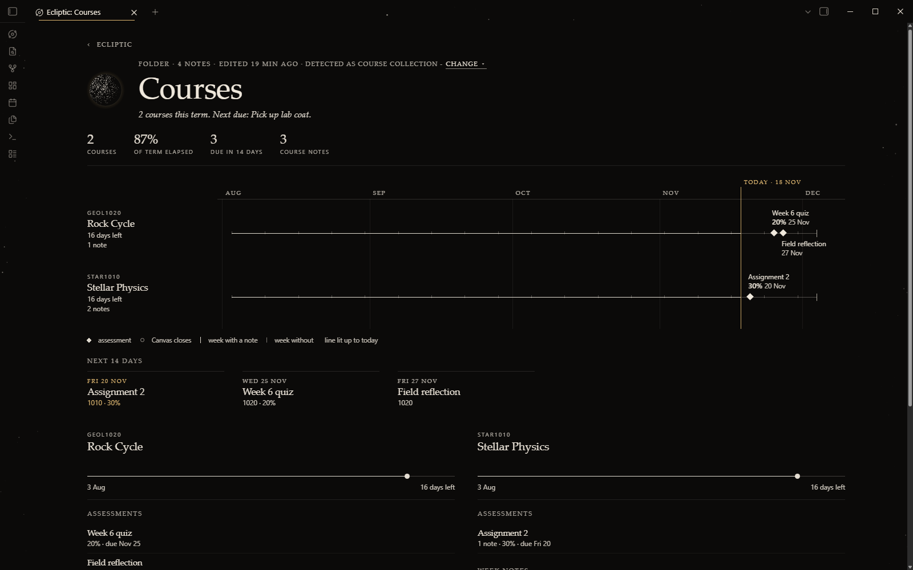
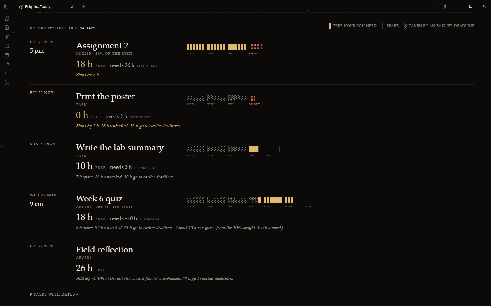
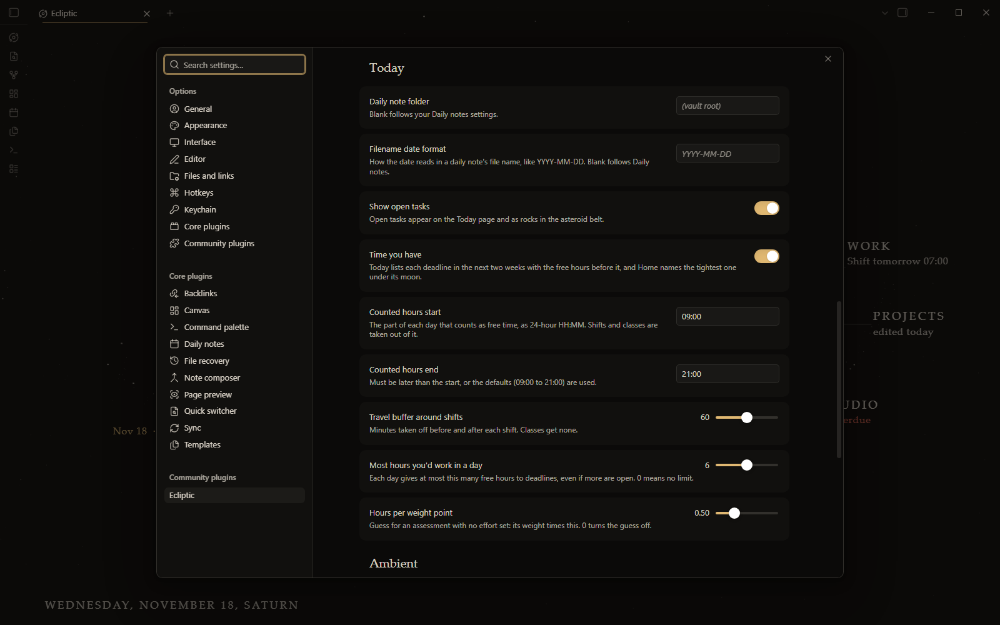

# Ecliptic

Ecliptic is a start screen for Obsidian. Your top-level folders orbit a planet. Click the planet for Today. Click a folder for a page built for what is inside it.

It reads your notes as they are. There is nothing to set up, and it only changes a note when you click something that says so, such as ticking off a task or creating today's note. [Privacy](#privacy) lists every case.



## Install

Needs Obsidian 1.5.0 or later. It works on desktop and on phones. There are three ways to install it, in the order to prefer.

### 1. Community plugins

Once Ecliptic is listed: open Settings, then Community plugins, then Browse, and search for "Ecliptic". Install it and turn it on.

### 2. BRAT

Until it is listed, BRAT installs it straight from this repository and keeps it updated.

1. Install **Obsidian42 - BRAT** from Community plugins and turn it on.
2. Run the command "BRAT: Add a beta plugin for testing".
3. Paste the repository URL: `https://github.com/voida6/ecliptic`
4. Turn on Ecliptic under Community plugins.

### 3. Manual

1. Download `main.js`, `manifest.json` and `styles.css` from the latest release into `<vault>/.obsidian/plugins/ecliptic/`. Make the folder if it is not there. Or unzip `ecliptic-0.1.0.zip` into `<vault>/.obsidian/plugins/` and it makes that folder for you.
2. In Obsidian, open Settings, then Community plugins, and turn on Ecliptic.

Then open it from the ribbon icon, or run the command "Open home".

## Try it on a demo vault

To see it with something in it, download `ecliptic-demo-vault.zip` from the latest release and unzip it. In Obsidian, choose "Open folder as vault" and pick the unzipped folder. Obsidian asks whether to trust the vault's plugins: choose yes, because the demo ships Ecliptic in it. Then click the Ecliptic icon in the left ribbon. On first open it asks whether to theme the whole app; either answer is fine.

The demo notes are made up: a few courses, a roster, a journal and some projects. Its date is pinned to 18 November 2026 so the numbers match the pictures here. To unpin it and use the real date, close Obsidian, open `.obsidian/plugins/ecliptic/data.json` and change the `debugDate` value to `""`. The same key pins any other day you want to look at, for example `"2026-12-01T12:00:00"`.

## What each page does

### Home

Each top-level folder with notes is a moon. The line under its name is the most useful fact about it, in this order:

1. How many tasks are overdue.
2. The tightest deadline in the next two weeks: how many hours short it is, or the free hours before it (see Time you have).
3. The next task that has a due date.
4. The next shift or class still to come, if the folder holds a roster or timetable.
5. How many notes were edited today.
6. When it was last edited.

Click a moon to open its page. Click the planet or the Today label for Today. The date at the bottom travels to the next world. On a phone the moons become a row under the planet.

### Today



- Today's note: the first lines of it, or a link to create it.
- Open tasks from the whole vault, overdue ones first. Tick one to mark it done in its note.
- Recently edited notes.
- The week, with due dates and shifts laid out by day and hour.
- The moon's phase, and sunrise and sunset once you set a place.



### Folder pages

Ecliptic looks at a folder and picks a page for it. The line at the top says what it chose. Use "Change" there to pick another type. To fix a type for good, put `ecliptic: work` (or `course`, `queue`, `projects`, `journal`, `plain`) in the folder note's properties. To keep a folder off Home, switch it off in Settings under Home folders.

A folder note is `Folder/Folder.md` or `Folder/index.md`. It is linked at the top and not listed as a note.

**Work and career.** A week grid of shifts, the next shift, hours rostered, a list of jobs, applications and a kit of documents.



**Journal.** The week as seven moons, a dot under each day that has a note, and the entries grouped by month.



**Courses.** One page for all courses: a timeline of assessments across the term, what is due in the next 14 days, and a column for each course.



**Projects.** Projects in lanes: active, parked, abandoned and unknown, with done projects folded under a "Done" toggle.

**Reading queue.** Notes grouped by category, split into read and unread.

**Plain folder.** Everything else: recent notes, subfolders and open tasks.

## How your notes are read

This is what Ecliptic looks for. If a note follows these shapes, it shows up.

### Tasks

```
- [ ] Return library book 📅 2026-11-18
```

- An open box is a task. The date after `📅` is its due date, or a Dataview field `[due:: 2026-11-18]` (round brackets work too). Without one, it is open with no date.
- Effort for the time check is `⏱ 2h` or `[effort:: 2h]`. Both fields are left out of the task's title.
- A task is overdue when its date is before today.
- A box whose text starts with `~~` (struck through) is ignored.
- Notes inside a `Templates` folder are skipped.
- Ticking a task in Ecliptic changes `[ ]` to `[x]` and adds `✅` and the date.

### Shifts and rosters

A line that gives a time range is a shift, not a task. It is never open and never overdue. Two forms are read.

A checkbox line with a time range and a date:

```
- [ ] 10:00 - 15:00 Job 📅 2026-11-17
```

A dated bullet. Give the year once in a "Week of" line above it:

```
Week of 16 November 2026
- Tuesday 17 November: 10:00-15:00
- Thursday 19 November: 07:00-13:00
```

Also read:

- `- 2026-11-17 10:00-15:00 Shop`
- `- Tue 17 Nov 10:00 to 15:00`
- `- Tue: 10:00-15:00`, when a "Week of" line sits above it

Where it looks for rosters:

- Notes in a folder named Work, Jobs, Roster or Rota.
- Notes with `type: job`, `work` or `roster`.
- Notes whose name has "roster", "rota" or "shift".

The text left after the time range and date is the job name. A shift belongs to a job when it sits in that job's note, uses the job's name, or comes from a roster note that names one job.

A folder is detected as work when it is named Career, Work, Jobs or Employment, or holds two notes typed `job`, `work` or `roster`. Inside it:

- Notes in a `Kit` folder are the kit.
- Notes in an `Applications` folder are applications.

### Courses

A course is a folder that has one of these:

- A name that starts with a course code, such as `ABCD1234` (three to five letters, then three to five digits), and some content.
- An overview note with `type: course` in its properties.
- An overview note next to a weeks folder.

Two or more courses under a folder make that folder a course collection.

**Term.** A `Runs:` line in the course's folder note or overview note, or a `runs:` property:

```
Runs: Mon 12 Oct → Fri 27 Nov 2026
Runs: 2026-10-12 to 2026-11-27
```

Without it, the end of the term is guessed from the last assessment and the last week note, and the page says so.

**Weeks.** Notes named `W1`, `W2` or `Week 1`, `Week 2`. The current week is picked from the term dates.

**Assessments.** Any of these:

A table under a heading called `Assessments`. The first column is the title. Columns whose headers contain "due", "deadline" or "date", and "weight", "worth" or "%", are used:

```
## Assessments

| Item | Type | Due | Weight |
|------|------|-----|--------|
| 1 - Kepler's laws | Assignment | 23 Oct 2026 | 20% |
| Final exam | Exam | 27 Nov 2026 | 50% |
```

A note in the course with `type: assignment` (or `exam`, `quiz`, `assessment`):

```
---
type: assignment
due: 2026-11-20
weight: 30
status: in-progress
---
```

A folder named Assignments, Assessments, Quizzes, Exams, Labs, Projects or Reports. Each subfolder inside is one assessment, and its notes' `due` dates are used.

Other details:

- `weight` can be a number or a line in the note such as `Weight: 30%`.
- With no date property, a line such as `Due Sun 1 Nov 2026` in the note works.
- `status: done` (or complete, submitted, graded, finished, closed) takes it out of the overdue count.
- A line such as `Canvas window: available 27 Aug - 20 Nov` marks when the course closes.

### Time you have



Today has a "Before it's due" section for the next two weeks. Each deadline shows the free hours before it, as one pip per hour grouped by day. Free hours are the counted hours of each day (09:00 to 21:00 by default) minus shifts and classes. A shift also loses a travel buffer on each side (1 hour by default). Entries labelled lecture, class, tutorial, lab, seminar or workshop count as classes and get no buffer. A daily cap (6 hours by default, 0 for none) limits how many of those hours one day can give, so a free weekend does not count as twelve hours of work. Deadlines are taken earliest first, so a later one only sees the hours the earlier ones leave.

"Free" means outside the commitments Ecliptic recognises: the shifts and classes it found in your notes (the "Based on" line under the section lists the counted hours and how many it found). Meals, rest, other jobs and anything it could not read are not subtracted, so treat a free number as an upper bound. The big number on a row is the hours left after earlier deadlines take theirs, the same number Home shows; when the two differ, the reason line gives the unbooked total. "Show open tasks" only hides tasks, shifts and classes still count.

How many hours a deadline needs comes from one of three places, and each row says which:

- **Set**: an `effort` property on the assessment note (`effort: 26h`, `90 min`, `1.5 hours`, or a bare number for hours), or `⏱ 2h` on a task line.
- **Estimated**: from the weight, 0.5 hours per point by default, shown as `~10 h`.
- **Unknown**: the row shows the free hours and a short "Add effort" hint, and reserves nothing. Tasks with a date but no effort are gathered into one line, and a one-time note under the section explains how to add effort (it can be closed).

When a deadline is short, the row says by how many hours and names the shift or class that costs the most. A due date with no time counts the whole day; a time in the `due` property (`due: 2026-11-20 17:00`) or in the Due cell of the assessments table ends the day there.

On Home, the folder moon holding the tightest deadline reads like `Assignment 2: 8 h short`, or `Quiz: 18 h free` when it fits. With no roster and no classes every counted hour (up to the daily cap) is free, so a warning only shows when the hours needed are more than that.

### Projects

The `status` property of each note or folder note picks the lane.

| Lane | Values |
|------|--------|
| Active | active, in-progress, planning, ongoing, doing, wip, started |
| Parked | on-hold, paused, backburner, simmering, parked, someday, later |
| Done | done, complete, completed, shipped, released, finished |
| Abandoned | abandoned, cancelled, dropped, dead |

A project with no status, or a status not in this table, goes in an **Unknown** lane. It still counts as live work, so its due dates show. Other properties used:

- `due: 2026-12-01` adds a date and can make it overdue.
- `summary` or `description` becomes the one-line description.

A folder is detected as projects when at least three of its notes have a status across two or more lanes, or three notes have `type: project`, or it is named Projects and has three or more items.

### Journal

Notes named `2026-11-16` (a day), `2026-W46` (a week) or `2026-11` (a month). They are grouped by month, newest first.

A folder is detected as a journal when:

- It is your daily note folder.
- It is named Journal, Daily or Diary and has three or more dated notes.
- At least five notes are in it and 60 percent or more have dated names.

Today's note follows the core Daily notes plugin: its folder, date format and template. The settings below can override them. A template can use `{{date}}`, `{{time}}` and `{{title}}`.

### Reading queue

Notes with a `status` of read, finished, unread, to-read, reading, queue or backlog, or `read: true` or `false`. A `summary`, `source`, `url` or `author` property is shown or used where it fits.

## Settings

**Appearance**
- World: Earth, Jupiter, Saturn, Neptune, Pluto, a black hole or Betelgeuse. Saturn is the default.
- Worlds in rotation: the date at the bottom of Home goes through the ticked worlds.
- Theme the whole app: colours Obsidian's sidebars, tabs, editor and dialogs after the world. It is asked once, the first time you open Ecliptic. It works in dark mode only. In light mode Obsidian is left alone.
- Tint accents: colours only links and checkboxes. It is off while the whole-app theme is on.
- Immersive: hides the sidebars, ribbon and status bar.
- Open on startup.

**Home folders**
- Maximum folder moons.
- A label and a show switch for each folder.

**Today**
- Daily note folder and filename date format. Blank follows the Daily notes plugin.
- Show open tasks.
- Time you have: the section on or off, the hours of the day that count, the travel buffer around shifts, the most hours you'd work in a day, and hours per weight point (0 turns the guess off).



**Ambient**
- Debris and moon speed.

**Place and sky**
- Place, latitude and longitude. They set sunrise, sunset and which side of the moon is lit. Latitude south of the equator flips the moon for the southern hemisphere. With no latitude set, the time zone is used.
- Live weather, off by default.

## Privacy

Ecliptic reads and writes inside your vault only. It has no account, no analytics and no server of its own.

### What it writes to your notes

Ecliptic changes a file only when you click or run something that says so. Nothing is written in the background, and it never deletes or renames a note. These are all of the ways it writes:

- **Ticking a task** on Today or a folder page. The line in its note becomes `[x]` with a done date (` ✅ YYYY-MM-DD`). A repeating task (`🔁 every ...`) is handed to the Tasks plugin, which writes the done line and the next occurrence. Without the Tasks plugin, a repeating task is not ticked: the note opens at that line instead.
- **Creating today's daily note**, from "Create today's note" or the "Open today's note" command when there is none yet. It uses your Daily notes folder, format and template, and creates any missing folders on the way.
- **Setting a folder's type** with "change" on a folder page. It sets or clears an `ecliptic:` property in that folder's folder note.
- **Creating a folder note** when you set a type on a folder that has none, after you confirm "Create ...?". The new note holds only the `ecliptic:` property.
- **Marking a reading item read** in a reading queue. It sets `read: true` and/or `status: read` in that note's properties.
- **New folder** on the empty first-run screen. It makes a folder with one empty `Untitled.md` in it.

Outside your notes, Ecliptic saves its own settings in its plugin folder (`data.json`).

Two things use the network, and both are yours to start:

- The "Look up" button next to Place sends the place name to open-meteo.com to find its coordinates.
- Live weather, when you turn it on, sends your latitude and longitude to open-meteo.com every 15 minutes. It is off by default.

Nothing else leaves the vault.

## Licence

MIT. See `LICENSE`.
